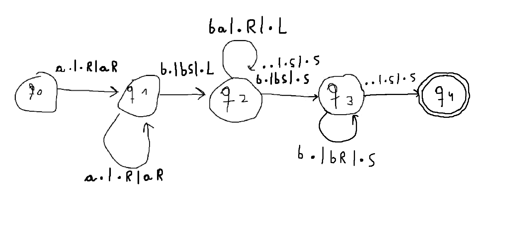
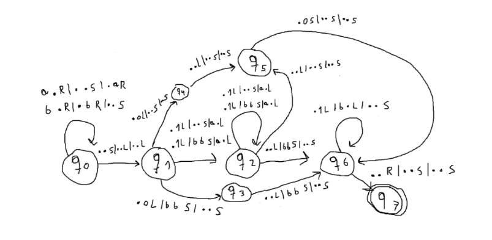

# Turing Machine

This is an academic project consisting of the implementation of a **deterministic multitape Turing machine simulator** from scratch in C++, with an object-oriented design and following some design patterns, such as the Strategy pattern.

The Turing machine is loaded from a plain text configuration file and can be executed with different input strings, which can be introduced manually through the terminal or read from a file. After the execution, the program shows if the machine stopped in an acceptance state and the content of every tape, indicating the current position of each read/write head.

The Turing machine implemented in this project has the following characteristics:

- **Simultaneous writing and head movement**.
- The heads can move to the **left (L)**, to the **right (R)** or **stay in the same position (S)**.
- The tapes are **infinite in both directions**.
- The machine is **deterministic**, so there can only be one possible transition for each current state and combination of symbols being read.
- The execution finishes when there is no transition defined for the current configuration.

## Author

Javier Acosta Portocarrero - alu0101660769@ull.edu.es - javier.acosta.porto@gmail (personal)

## Structure

I structured the program in the next main classes:

- **TuringMachineTape**: represents one of the tapes of the Turing machine. Internally, I used a `std::list` to be able to extend the tape efficiently in both directions whenever the head reaches one of its limits. It stores an iterator representing the current position of the read/write head and provides methods to read the current symbol, write a new one and move the head to the left, right or keep it in the same position. It also checks that the input word belongs to the input alphabet and that every written symbol belongs to the tape alphabet. The string representation of the tape indicates the current head position using brackets, for example `ab[c]d`.
- **InstantaneousDescription**: represents the information needed to know which transition can be executed at a certain moment. It contains the current state of the Turing machine and a string containing the symbol currently being read from each tape. It also implements the comparison operator needed to use it as the key of the transition map.
- **TransitionEffects**: represents the effects of applying a transition. It contains the destination state and, for each tape, the symbol that has to be written and the movement that its head has to perform.
- **TransitionFunction**: contains and manages all the transitions of the Turing machine. I used a `std::map` with an `InstantaneousDescription` as key and a `TransitionEffects` as value. As the Turing machine is deterministic, there can only be one transition for each combination of current state and symbols being read. If there is no transition for the current instantaneous description, the execution of the machine finishes.
- **TuringMachine**: represents the complete deterministic multitape Turing machine. It contains the states, input alphabet, tape alphabet, initial state, blank symbol, acceptance states, transition function and all the tapes. The input word is initially introduced only into the first tape while the rest start with a blank symbol. During the execution, it obtains the transition corresponding to the current state and symbols under the heads, writes the new symbols and moves all the heads according to that transition. When no more transitions can be executed, the word is accepted if the current state belongs to the set of acceptance states.
- **StringMovements**: enum used to represent the three possible movements of a tape head: `right`, `left` and `stop`, corresponding to `R`, `L` and `S` in the configuration file.
- **TuringMachineLoaderStrategy**: abstract class that defines the interface that a Turing machine loader strategy has to follow. I used the Strategy pattern here so different ways of loading a Turing machine could be added without changing the rest of the program.
- **TuringMachineLoaderPlainTextStrategy**: implementation of the loader strategy for plain text files. It reads the complete definition of the Turing machine and checks that the format and its elements are valid. For example, it checks that the initial and acceptance states belong to the set of states, that the input alphabet is contained in the tape alphabet, that the blank symbol belongs to the tape alphabet but not to the input alphabet, that the number of tapes is valid and that all symbols and movements used in the transitions are correct. It also checks that two transitions cannot have the same requirements, since the implemented Turing machine is deterministic. Lines can contain comments using the `#` character.
- **TuringMachineLoader**: manages the strategy used to load the Turing machine. It receives a `TuringMachineLoaderStrategy` and a configuration file path and uses them to create the `TuringMachine`. This way the main program does not need to know how the machine is actually loaded.
- **Custom exceptions**: the program uses the custom exception classes `InputException`, `TuringMachineException` and `TuringMachineStringTape`, all derived from `std::runtime_error`. `InputException` is used for errors related to command line arguments and invalid configuration or input files, `TuringMachineException` is used for inconsistencies related to the Turing machine itself and `TuringMachineStringTape` is used for invalid tape operations or symbols.

The `main` program is in charge of reading the command line arguments, loading the Turing machine and reading the input strings. The strings can be introduced manually through the terminal or read from a file using the `-in` option. Before processing every new word, the machine and all its tapes are reset to their initial state.

## How to execute the program

First, you need to have installed `g++` with support for C++23 and `make`.

To compile the complete project, execute from the root directory:

```bash
make
```

The executable will be generated inside the `build` directory:

```bash
build/turing_machine
```

To remove all the compiled files:

```bash
make clean
```

The program has one obligatory parameter, `-config`, and an optional one, `-in`:

```bash
./build/turing_machine -config <file> [-in <file>]
```

Each parameter has the following meaning:

- `-config <file>` specifies the plain text file containing the Turing machine configuration.
- `-in <file>` is optional and specifies a file containing the input strings to check. If it is not given, the strings can be introduced manually through the terminal.

When introducing the strings manually, type `exit` to stop the execution.

After exec

## Ejercicios

**Primer ejercicio**: MT que reconozca el lenguaje L = { a^nb^m | m ≥ n, n > 0 }

Diagrama del diseño propuesto:


Descripción de sus componentes:

Conjunto Q
q0 q1 q2 q3 

Conjunto Σ
a b  

Conjunto Γ
a b .  

Estado inicial
q0 

Símbolo blanco
.  

Conjunto F
q3  

Número de cintas
2  

función de transición:
- q0 a . q1 . R a R
- q1 a . q1 . R a R
- q1 b . q2 b S . L
- q2 b a q2 . R . L
- q2 b . q3 b S . S
- q2 . . q3 . S . S

**Segundo ejercicio**: MT que reciba como parámetro una cadena compuesta por símbolos ‘a’ y ‘b’. La MT debe sustituir la cadena por el número de símbolos ‘b’, seguido del número de símbolos ‘a’ separados por un símbolo blanco. El número se codificará como n = 1^n.

Diagrama del diseño propuesto:


Descripción de sus componentes:

Conjunto Q
q0 q1 q2 q3 q4 q5 q6 q7  

Conjunto Σ
a b 

Conjunto Γ
a b 1 0 .  

Estado inicial
q0 

Símbolo blanco
. 

Conjunto F
q7 

Número de cintas
3  

Función de transición:
q0 a . . q0 . R . S a R
q0 b . . q0 . R b R . S
q0 . . . q1 . S . L . L
q1 . b a q2 1 L b S . L
q1 . . a q2 1 L . S . L
q1 . b . q3 0 L b S . S
q1 . . . q4 0 L . S . S
q2 . b a q2 1 L b S . L
q2 . . a q2 1 L . S . L
q2 . . . q5 . L . S . S
q2 . b . q6 . L b S . S
q3 . b . q6 . L b S . S
q4 . . . q5 . L . S . S
q5 . . . q6 0 S . S . S
q6 . b . q6 1 L . L . S
q6 . . . q7 . R . S . S